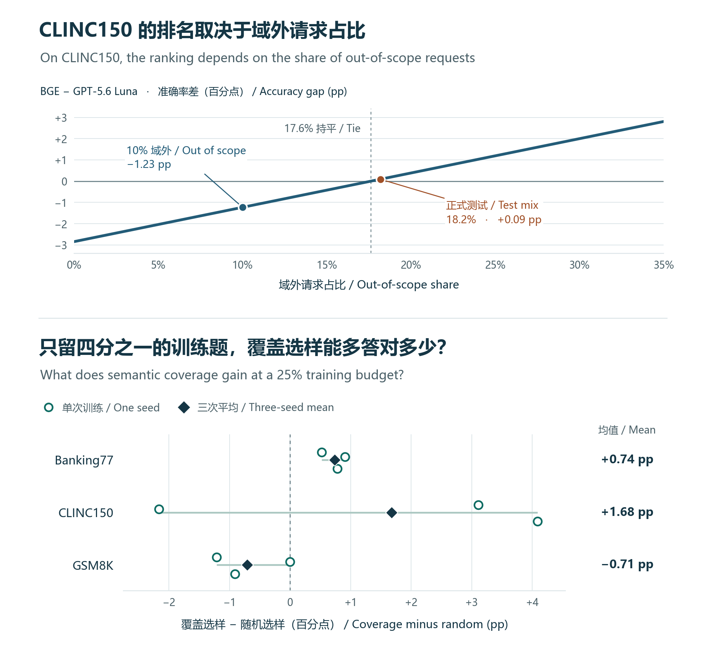

# 一张考卷到底需要多大的模型？

如果一个模型只需要考好一张卷子，可以把它做得多小？给银行工单分流的模型可以完全不懂几何。只要它能分清客户的 77 种来意，整张卷子的成绩追得上闭源模型，训练便宜、回复又快，就有实际用处。更难的问题是，把银行工单换成小学数学题，给它一套新训练数据，同一种办法还能不能奏效？

我在一张 8 GB 的 GTX 1070 上训练小模型，让它们分别做完四张考卷。最接近这个设想的是 CLINC150。一个 3,327 万参数的模型答对了 5,500 道中的 5,210 道，比可以检索训练样例的 GPT-5.6 Luna 多五道。到了小学应用题，我从同一个 7,696 万参数的语言模型出发，让两个学生都练 6,725 道题。学着直接报数的答对 27 道，学着写可执行算式的答对 123 道。两种任务的答案都很短，压缩它们的难度却相差很大。

## 四张完整考卷

我把领域限定为一个数据集。每份数据单独训练一套权重，测试卷上的每道题都计分。工单模型从合法标签中选一个，数学模型必须给出数值，无法解析的答案也计错。闭源分数取自他人在同一份测试卷上的公开实测。

| 完整测试集与本地设置 | 本地答对数 | 本地准确率 | 闭源参照 |
| --- | ---: | ---: | ---: |
| Banking77，按验证总分选模型 | 2,866 / 3,080 | 93.05% | 93.80% |
| CLINC150，按验证总分选拒答阈值 | 5,107 / 5,500 | 92.85% | 94.64% |
| CLINC150，已知与域外请求等权选阈值 | 5,210 / 5,500 | 94.73% | 94.64% |
| GSM8K，直接生成数字 | 27 / 1,319 | 2.05% | 97.12% |
| GSM8K，生成程序后执行 | 123 / 1,319 | 9.33% | 97.12% |
| AIME 2026，直接生成数字 | 0 / 30 | 0.00% | 100.00% |

两份工单的参照都是 GPT-5.6 Luna。只给它 77 个类别名，Banking77 得分是 85.4%。允许它查阅 20 条相似的训练样例，同时约束输出格式，得分升到 93.8%。给专精模型用过的资料，部署闭源系统的人同样有理由拿去做检索。数学两卷的参照分别是 Gemini 2.5 Pro 和 GPT-5.5（xhigh）。这些分数对应具体模型与设置，不能替代所有当代旗舰的同卷比较。[工单评测设置](https://illate.dev/luna-vs-fine-tuned-model) · [工单原始分数](https://illate.dev/bakeoff.json) · [GSM8K 原卷评测](https://arxiv.org/abs/2602.13217) · [AIME 逐题榜](https://matharena.ai/?comp=aime--aime_2026&view=problem)

我还保留了一个真正跨任务的对照。每次都从同一个 FLAN-T5-small 预训练底座出发，每套训练数据都练两遍。让它在两份工单卷上各生成一个合法类别词元，在两份数学卷上直接报数，结果依次为 **87.01%、85.40%、2.05%、0.00%**。同一训练流程可以搬过去，得分没有随之迁移。

## 多出来的五道题从哪里来

CLINC150 考助手能否识别 150 种已知意图，也考它能否认出一条请求超出了业务范围。我用 OOS+ 版的 15,000 条已知请求和 250 条域外请求微调 BGE-small。验证时我用了两种预先定下的准则。一种让整份验证集答对的题最多，另一种给已知请求的准确率和域外请求的召回率各一半权重。两种准则选中了同一轮模型权重，最后只差一个拒答阈值。[CLINC 原始数据与切分](https://github.com/clinc/oos-eval/tree/828f8093932c8fe6ca7936c3d2e52903b1c523de/data)

| 系统与阈值 | 已知请求答对 / 4,500 | 域外请求答对 / 1,000 | 合计 / 5,500 |
| --- | ---: | ---: | ---: |
| 本地 BGE，验证总分 | 4,354 | 753 | 5,107 |
| 本地 BGE，两组等权 | 4,286 | 924 | 5,210 |
| GPT-5.6 Luna，检索示例 | 4,414 | 791 | 5,205 |

为什么在验证集追求最高总分，正式卷上反倒少对 103 道？验证卷的域外请求只有 100/3,100，测试卷却有 1,000/5,500。改用等权门槛，多认出 171 条域外请求，少分对 68 条已知请求，净增恰好 103 道。

与 Luna 相比，等权模型多认出 133 条域外请求，少分对 128 条已知请求。两者至少在 261 道题上的对错不同，总分只差五道。假定两组内的命中率保持不变，两者的总准确率在域外请求占比约 **17.6%** 时相交，正式卷恰好是 **18.2%**。如果一家客服中心的域外请求只占 10%，按同样的命中率重算，小模型得 94.96%，Luna 得 96.19%。五道题足以决定这张固定考卷的名次，还不足以说明换一批流量以后谁更好。[闭源系统的分项结果](https://illate.dev/luna-vs-fine-tuned-model)

图的上半部分按实测的分组命中率重算。下半部分是实际重训得到的分差，每个圆点代表一个训练子集的随机种子，菱形代表三次平均。

## 能压到二十万参数吗？会不会只是背题？

我把每个词随机映射成向量，用宽度为 2、3、4 的卷积读取词组。Banking77 的这张小网只有 **198,349 个参数**。我让一对初始权重相同的学生按相同顺序做题，一个只学标准标签，另一个还能看见 BGE 教师对每个类别的打分。三次训练平均下来，银行卷从 87.69% 升到 **88.51%**，CLINC 从 80.86% 升到 **83.92%**。教师用过通用预训练，学生从随机值开始，推理时可以独立运行。这组 CLINC 对照使用标准版的 100 条域外训练样本，两版的验证卷和测试卷逐项相同。

在 Banking77，冻结 BGE、只训练线性分类器得 93.05%。微调整个 BGE 得到 **2,878/3,080（93.44%）**，距离闭源参照只差 11 道。但冻结版在 1,001 道验证题上多答对三道，所以按事先选定的验证指标，交卷的是冻结版。两种成绩都值得报告，因为部署前只能看见其中一种选择依据。

我用训练原文和措辞相似度检查了记忆的影响。微调 BGE 的银行卷训练、验证、测试分数分别为 97.62%、93.91%、93.44%。忽略标点和大小写，删除与训练文本重合的 22 道测试题后，余下 3,058 道仍答对 2,856 道（93.39%）。再在每个意图内部按措辞与最近训练题的相似度排序，最陌生的 770 道得 **88.1%**，最熟悉的 770 道得 **96.5%**。即使识别的是同一批意图，换种措辞也值得单独考一次。

CLINC 等权模型在训练、验证、测试上分别得 99.59%、95.87%、94.73%，三份数据的域外请求占比也不同。去掉与训练文本重复的 19 道测试题，剩余 5,481 道仍答对 5,192 道（94.73%）。这些重复题对总分影响很小。要区分预训练时可能见过公开题的影响，以及模型应对新客户说法的能力，还得收集新题。

卷积和 BGE 在这里部署成分类器，只返回类别编号。FLAN-T5 是能逐词生成答案的条件语言模型。用分类器答好一份分类卷，已经实现了那个任务的目标。换到数学卷，还得检验学生能否自己构造答案。

## 如果只许留四分之一的训练题

我先用冻结的 BGE 编码所有训练题干。从一条随机题出发，每次选离已有样本最远的一条。选题时看不到答案。每份数据都用同一种线性分类器训练，和相同预算的随机抽样比较，最后仍答完整考卷。[贪心 k-center 选样方法](https://openreview.net/forum?id=H1aIuk-RW)

Banking77 每次留 2,250 条，两种选法三次都凑齐了 77 类。覆盖选样仍比随机抽样多答对 **24、16、28** 道，平均多 0.74 个百分点。选同一个意图的哪几种说法，也会影响分数。CLINC 每次留 3,775 条，三次分别多对 225、171 道和少对 119 道，平均多 1.68 个百分点。只报告第一次，会把这条规则说得过于可靠。

GSM8K 每次留 1,681 条。覆盖选样三次都见到了更多种标准答案，结果却依次少对 12 道、少对 16 道、持平。即使看完整训练集，1,319 道测试题中有 1,226 道的正确数字在训练里出现过，把数字当标签的分类器也只答对 49 道。永远猜训练中最常见的数字 4，都能碰对 35 道。

我又给能生成数字的 FLAN 同样的 1,681 题，各练两遍。随机抽样答对 26 道，按题面语义覆盖答对 13 道。如果读取人工解答，把“先乘再减”这样的运算顺序各算一类，硬挑 1,681 种不同顺序，只答对 **10** 道。按每种顺序在训练集里的原始占比分配名额，覆盖 760 种，反而答对 **27** 道。追求种类最多，使 1,191 个名额花在整个训练集中只出现一次的顺序上，随机组只有 315 个。这个生成对照每种方法只跑一个种子，而且按解法选题本身就需要人工算式。节省的首先是学生拟合的样本数。

## 教模型写一个能执行的解法

GSM8K 的人工训练解答同时提供步骤和数字。我从同一组 FLAN 权重出发，用同样的 6,725 道题比较几种教法。所有测试题都只给题干，各用贪心解码生成一次。直接报数最多生成 12 个词元，写算式或程序最多生成 72 个。

| GSM8K 的答题方式 | 答对 / 1,319 | 准确率 |
| --- | ---: | ---: |
| 预训练底座直接作答 | 9 | 0.68% |
| 用最终数字训练 | 27 | 2.05% |
| 用列式和最终答案训练 | 36 | 2.73% |
| 由计算器重算模型给出的最后一道算式 | 50 | 3.79% |
| 训练学生写整段可执行的算式，再执行 | 123 | 9.33% |

为什么计算器只救回来一部分？有道题说五个派各切八块，最后剩十四块。学生列对了 `5 × 8` 和 `40 − 14`，却把答案写成 21，重算就得到 26。另一题有十六个鸭蛋，吃三个、烘焙用四个，其余每个卖两美元。学生自己推导出有 72 个蛋可卖，还写成 `72 × 2 = 168`。算准最后一步会得到 144，正确答案却是 18。计算器能读懂 1,294 条末尾算式，救回 36 道，也改错 22 道。

再往前一步，我把训练解答编成程序，允许后一步引用前一步的结果，让执行器承担每一次四则运算。6,295 道训练题可以编成程序并验回标准答案，另外 430 道保留数字目标。测试时，这个学生救回了直接报数时做错的 119 道，也丢了原来做对的 23 道，净增 **96 道**。189 条输出无法执行，一律计错。把随机选的 1,681 道报数题增加到 6,725 道，只从 26 道对到 27 道。同样的 6,725 道题换一种监督信号，再给执行器，才到了 123 道。[GSM8K 的原始题目与解答](https://github.com/openai/grade-school-math)

AIME 更直接。用截至 2018 年的 770 道旧题训练、2019 至 2023 年的 149 道题做验证，直接报数的 FLAN 在 2026 年两场的全套 30 道题上得 **0/30**。MathArena 的 GPT-5.5（xhigh）在同卷上每题独立答四次，平均得分 100%，模型发布于赛后。这量出的是这套旧题、两轮训练和短数字输出预算的差距。[历年训练题](https://huggingface.co/datasets/philschmid/AIME_1983_2024) · [2026 年试题](https://huggingface.co/datasets/MathArena/aime_2026) · [MathArena 评测](https://matharena.ai/?comp=aime--aime_2026&view=problem)

## 省下的算力怎么记

| 本地任务与方案 | 部署参数 | 任务适配用时 | 单条延迟 p50 / p95 |
| --- | ---: | ---: | ---: |
| 银行，随机初始化卷积 | 19.8 万 | 7 秒 | 0.7 / 1.1 ms |
| 银行，冻结 BGE 加线性层 | 3,324 万 | 29 秒 | 11.0 / 14.7 ms |
| 银行，全量微调 BGE | 3,324 万 | 59 秒 | 9.1 / 11.3 ms |
| CLINC OOS+，全量微调 BGE | 3,327 万 | 79 秒 | 10.9 / 17.2 ms |
| GSM8K，FLAN 直接报数 | 7,696 万 | 136 秒 | 58.7 / 64.7 ms |
| GSM8K，FLAN 写算式和答案 | 7,696 万 | 176 秒 | 439.4 / 775.9 ms |
| GSM8K，FLAN 写程序 | 7,696 万 | 168 秒 | 230.3 / 381.0 ms |

每行都是在这张 GTX 1070 上单独运行。适配用时包含该方案的训练数据编码、搜索或验证。延迟从单条原文进入分词器计到输出标签或数字，预热后卷积和 BGE 各测 100 条，FLAN 测 40 条。冻结的银行模型只需拟合 29,645 个系数，部署时仍要带上整个编码器。复建银行蒸馏教师并生成软标签另花约 18 秒，还要计入此前选教师超参数的成本。

公开报告中，带检索示例的 Luna 在银行和 CLINC 的单请求中位延迟分别是 812 和 830 毫秒，含网络往返，未计检索。Luna 只需建立示例索引，任务上没有梯度更新。BGE 与 FLAN 的通用预训练成本也不在上表里。能够复核的是本地适配用时和响应速度，闭源完整参数量与预训练账单仍未知。[外部计时口径](https://illate.dev/luna-vs-fine-tuned-model) · [BGE 底座](https://huggingface.co/BAAI/bge-small-en-v1.5) · [FLAN 底座](https://huggingface.co/google/flan-t5-small)

这条路有先例。Casanueva 等在 2020 年就用句子编码器做银行意图分类。Hsieh 等在 ANLI 上用 80% 的训练数据，把教师给出的理由一并教给 7.7 亿参数的 T5，超过少样本提示下的 5,400 亿参数 PaLM。ILLATE 的 40 亿参数模型在 Banking77 得 94.0%、CLINC 得 95.1%。[银行意图论文](https://aclanthology.org/2020.nlp4convai-1.5/) · [逐步蒸馏论文](https://aclanthology.org/2023.findings-acl.507/) · [同卷比较](https://illate.dev/luna-vs-fine-tuned-model)

这轮实验能给出的具体答案是，CLINC150 这张固定考卷用 3,327 万个参数就够追到这里的闭源对照，前提是沿用预训练编码器，再花 79 秒做任务适配。从零训练的卷积学生加上蒸馏，同卷做到 83.92%。到了数学卷，1,226 道测试题的正确数字已经在训练中出现过，学生最缺的仍是从题干到运算的那一步。如何从一套新数据里判断学生该练习什么，让它换科之后也能追上闭源模型，仍是这项研究最值得做的问题。

# How Big Does a Model Need to Be for One Benchmark?

If a model only has to do well on one exam, how small can it be? A bank can live with a ticket router that knows nothing about geometry. What matters is whether it can sort requests into 77 categories, match a closed system's overall score, cost little to train, and answer quickly. The harder question is whether we can swap the bank tickets for grade-school maths problems, supply a new training set, and use the same recipe.

I trained small models on an 8 GB GTX 1070 and ran them on four complete test sets. The closest result came on CLINC150. A 33.27-million-parameter model answered 5,210 of 5,500 requests correctly, five more than GPT-5.6 Luna with retrieved training examples. On grade-school maths, two students started from the same 76.96-million-parameter language model and trained on the same 6,725 problems. The one taught to predict numbers directly got 27 test answers right. The one taught to write executable arithmetic got 123. Both tasks have short answers. They differ considerably in what it takes to produce one.

## Four complete exams

I treated one dataset as one domain. Each student got its own weights and every test item counted. The intent models could choose among the legal labels. The maths models had to produce a numerical answer, and an unparseable response counted as wrong. The closed scores come from published runs on the same tests.

| Complete test and local configuration | Local correct | Local accuracy | Closed reference |
| --- | ---: | ---: | ---: |
| Banking77, model chosen by overall validation accuracy | 2,866 / 3,080 | 93.05% | 93.80% |
| CLINC150, rejection threshold chosen by overall validation accuracy | 5,107 / 5,500 | 92.85% | 94.64% |
| CLINC150, equal validation weight for in-scope and out-of-scope requests | 5,210 / 5,500 | 94.73% | 94.64% |
| GSM8K, generate the number directly | 27 / 1,319 | 2.05% | 97.12% |
| GSM8K, generate and execute a program | 123 / 1,319 | 9.33% | 97.12% |
| AIME 2026, generate the number directly | 0 / 30 | 0.00% | 100.00% |

GPT-5.6 Luna was the reference on both intent tests. Given only the names of the 77 banking categories, it scored 85.4%. Adding 20 similar training examples and constraining the output format raised that to 93.8%. A team considering the closed system can put the same labelled data into a retrieval index. On the two maths exams the references were Gemini 2.5 Pro and GPT-5.5 (xhigh), respectively. Each score describes a specific system and setup. There are no corresponding results here for every current flagship. [Intent evaluation protocol](https://illate.dev/luna-vs-fine-tuned-model) · [Reported intent scores](https://illate.dev/bakeoff.json) · [Original GSM8K evaluation](https://arxiv.org/abs/2602.13217) · [AIME results by problem](https://matharena.ai/?comp=aime--aime_2026&view=problem)

I also ran a common baseline across all four. Each student started from the same pretrained FLAN-T5-small weights and saw its own training data twice. It produced one legal label token on each intent dataset and generated numbers directly on the maths datasets. Its four scores, in the order banking, assistant intents, grade-school maths, and competition maths, were **87.01%, 85.40%, 2.05%, and 0.00%**. It was straightforward to transfer the training procedure. The performance did not follow.

## Where the five extra answers came from

CLINC150 asks an assistant to recognise 150 known intents and to detect requests outside its remit. I fine-tuned BGE-small on the OOS+ split, with 15,000 in-scope and 250 out-of-scope training requests. I set two criteria for validation. The first maximised total correct answers. The second weighted in-scope accuracy and out-of-scope recall equally. Both selected the same training checkpoint. Only the rejection threshold differed. [Original CLINC data and splits](https://github.com/clinc/oos-eval/tree/828f8093932c8fe6ca7936c3d2e52903b1c523de/data)

| System and threshold | In-scope correct / 4,500 | Out-of-scope correct / 1,000 | Total / 5,500 |
| --- | ---: | ---: | ---: |
| Local BGE, overall validation accuracy | 4,354 | 753 | 5,107 |
| Local BGE, equal weight for the two groups | 4,286 | 924 | 5,210 |
| GPT-5.6 Luna, retrieved examples | 4,414 | 791 | 5,205 |

Why did maximising the validation total cost 103 correct answers on the test? Only 100 of the 3,100 validation requests were out of scope, compared with 1,000 of 5,500 on the test. The equal-weight threshold caught 171 additional out-of-scope requests and sacrificed 68 correct in-scope classifications. That accounts for all 103.

Against Luna, the local model caught 133 more out-of-scope requests and classified 128 fewer in-scope requests correctly. Their correctness must therefore differ on at least 261 items, even though their totals differ by five. Holding their measured within-group rates fixed gives a crossover at **17.6%** out-of-scope traffic. The test set happens to contain **18.2%**. At a service desk with 10% out-of-scope traffic, the same rates would give the local model 94.96% and Luna 96.19%. Five answers settle the ordering on this particular exam. The ordering on a new workload depends on who turns up. [Published breakdown for the closed system](https://illate.dev/luna-vs-fine-tuned-model)

The upper panel reweights the observed within-group rates. The lower panel shows actual retraining runs. Each circle is a seed for choosing the training subset, and each diamond is the mean of three runs.

## Can 200,000 parameters do it? How much is memorisation?

I started with random word embeddings and convolutions spanning two, three, or four tokens. The banking model had **198,349 parameters**. Each matched pair of students started with identical weights and saw examples in the same order. One learned from the correct labels alone. The other also saw a trained BGE teacher's scores for every class. Across three training seeds, distillation took Banking77 from 87.69% to **88.51%**, and CLINC from 80.86% to **83.92%**. The teacher inherited general pretraining. The student started from scratch and can run on its own. These CLINC runs used the standard training split with 100 out-of-scope examples. Its validation and test items are identical to those in OOS+.

On Banking77, freezing BGE and fitting a linear classifier gave 93.05%. Fine-tuning the encoder gave **2,878/3,080 (93.44%)**, just 11 answers short of the closed reference. The frozen model, however, had answered three more of the 1,001 validation items correctly. It was the model the selection rule would have shipped. Looking at the test table after the fact gives a different choice.

To check memorisation, I compared exact overlap and wording similarity. The fine-tuned banking encoder scored 97.62% on training, 93.91% on validation and 93.44% on test. After normalising case and punctuation, 22 test questions matched training text. Removing them left 2,856 correct out of 3,058 (93.39%). Within each intent I then sorted questions by their lexical similarity to the closest training question. Accuracy was **88.1%** on the least familiar 770 and **96.5%** on the most familiar 770. Even with a fixed set of intents, unfamiliar wording deserves a test of its own.

The equal-weight CLINC model scored 99.59% on training, 95.87% on validation and 94.73% on test. The three splits also contained different proportions of out-of-scope requests. Removing the 19 test requests that matched training text still left 5,192 of 5,481 correct (94.73%). Those repeats had little effect on the score. A fresh evaluation set could test how well the model handles new customer wording without the risk of public test questions having appeared in pretraining.

All three architectures are neural networks. The deployed CNN and BGE systems return a category ID. FLAN-T5 is a conditional language model that can generate an answer token by token. A classifier is sufficient for a classification exam. A maths exam lets us test whether a small model can construct the answer itself.

## Which quarter of the training set should we keep?

I embedded every training question with frozen BGE. Starting from a random question, I repeatedly added the one farthest from the examples already selected. Selection used question text alone. On each dataset I trained the same kind of linear classifier and compared it with a random subset of identical size. Both answered the complete test set. [Greedy k-center selection](https://openreview.net/forum?id=H1aIuk-RW)

On Banking77, each subset contained 2,250 questions. Both methods covered all 77 labels in all three runs. Semantic coverage nevertheless gained **24, 16, and 28** correct answers, a mean of 0.74 percentage points. The choice of wording *within* a label mattered. On CLINC, with 3,775 examples, the changes were +225, +171, and −119 correct answers, a mean of +1.68 points. Reporting just the first run would make selection look far more reliable than it was.

On GSM8K, each subset contained 1,681 problems. Semantic coverage exposed the classifier to more distinct answer values in every run, yet it lost 12 answers, lost 16, and tied random sampling. Even with all the training data, 1,226 of the 1,319 correct test numbers had occurred in training and the answer classifier got just 49 right. Always guessing 4, the most frequent training answer, got 35 right by chance.

I repeated the quarter-budget experiment with FLAN generating the answer. Each student saw 1,681 examples twice. Random sampling got 26 correct, and semantic coverage got 13. With access to the human solutions, I could also group questions by their sequence of operations, such as multiplication followed by subtraction. Spending the budget on 1,681 distinct sequences produced just **10** correct. Allocating places in proportion to the original frequency of each sequence covered only 760 types and produced **27** correct. Maximising variety spent 1,191 places on sequences that appeared just once in the entire training pool. Random sampling spent 315 on them. These generative comparisons used one seed each. Selecting by solution type also requires access to worked solutions across the candidate pool. The 75% reduction applies to the data ultimately fitted by the student.

## Teaching the model an executable solution

The human GSM8K solutions include both reasoning steps and answers. I trained students from the same FLAN weights on the same 6,725 problems. Each received only the question at test time and used one greedy generation per problem. The limit was 12 new tokens for direct answers and 72 for worked equations or programs.

| GSM8K answer method | Correct / 1,319 | Accuracy |
| --- | ---: | ---: |
| Pretrained model answering directly | 9 | 0.68% |
| Train on the final number | 27 | 2.05% |
| Train on equations and the final answer | 36 | 2.73% |
| Recalculate the last equation in the model's trace | 50 | 3.79% |
| Train on a whole executable arithmetic program and run it | 123 | 9.33% |

A calculator fixed some mistakes immediately. In one problem, five pies are cut into eight slices each and fourteen slices are left. The student wrote down `5 × 8` and `40 − 14` correctly, then reported 21. Recalculating gave 26. In another problem there are sixteen duck eggs, three are eaten, four go into baking, and the rest sell for two dollars each. The student invented 72 eggs for sale and wrote `72 × 2 = 168`. Recalculating gave 144. The correct answer was 18. The calculator could read 1,294 final equations. It rescued 36 answers and spoiled 22 that had been correct.

I then compiled the annotated training steps into programs in which each expression could reference an earlier result, leaving the executor to perform all the arithmetic. Programs for 6,295 training examples reproduced their gold answers. The other 430 retained numerical targets. On the test, the program student recovered 119 problems missed by the direct-answer student and lost 23 it had previously solved, a net **96 extra answers**. All 189 outputs that failed to execute counted as wrong. Expanding the random direct-answer training set from 1,681 questions to 6,725 had taken the score from 26 to 27. Changing the supervision on those same 6,725 examples and adding the executor took it to 123. [Original GSM8K questions and worked solutions](https://github.com/openai/grade-school-math)

AIME was a starker test. I trained the direct-answer FLAN student on 770 historical problems through 2018, validated it on 149 from 2019–2023, and gave it all 30 problems from the two 2026 exams. It scored **0/30**. MathArena reports 100% for GPT-5.5 (xhigh), averaged across four independent attempts per problem. That model was released after the contest. This comparison measures the limits of our historical data, two training passes and short-answer decoding budget. [Historical training problems](https://huggingface.co/datasets/philschmid/AIME_1983_2024) · [2026 problems](https://huggingface.co/datasets/MathArena/aime_2026) · [MathArena evaluation](https://matharena.ai/?comp=aime--aime_2026&view=problem)

## What the compute savings cover

| Local task and system | Deployed parameters | Task adaptation | Single-query p50 / p95 |
| --- | ---: | ---: | ---: |
| Banking, randomly initialised CNN | 0.198M | 7 s | 0.7 / 1.1 ms |
| Banking, frozen BGE and linear head | 33.24M | 29 s | 11.0 / 14.7 ms |
| Banking, fine-tuned BGE | 33.24M | 59 s | 9.1 / 11.3 ms |
| CLINC OOS+, fine-tuned BGE | 33.27M | 79 s | 10.9 / 17.2 ms |
| GSM8K, FLAN generating numbers | 76.96M | 136 s | 58.7 / 64.7 ms |
| GSM8K, FLAN generating worked equations and answers | 76.96M | 176 s | 439.4 / 775.9 ms |
| GSM8K, FLAN generating programs | 76.96M | 168 s | 230.3 / 381.0 ms |

I ran each configuration separately on the GTX 1070. Adaptation includes the encoding, search or validation required by that configuration. Single-query timing starts with raw text entering the tokenizer and ends when a label or number is ready. After warm-up I timed 100 requests for the CNN and BGE and 40 for FLAN. The frozen banking model fits just 29,645 coefficients, although deployment still requires the encoder. Rebuilding the distillation teacher and generating soft targets for Banking77 took a further 18 seconds before accounting for the earlier teacher hyperparameter search.

The published median API times for Luna with retrieved examples were 812 ms on Banking77 and 830 ms on CLINC, including the network round trip and excluding retrieval. Luna needed an example index and zero task-specific gradient updates. The general pretraining of BGE and FLAN also sits outside the table. We can measure the local adaptation cost and the time a user would wait. The closed model's full parameter count and pretraining bill remain unknown. [External timing protocol](https://illate.dev/luna-vs-fine-tuned-model) · [BGE checkpoint](https://huggingface.co/BAAI/bge-small-en-v1.5) · [FLAN checkpoint](https://huggingface.co/google/flan-t5-small)

There is precedent. In 2020, Casanueva and colleagues used sentence encoders for banking intent detection. On ANLI, Hsieh and colleagues taught a 770M T5 model the teacher's rationales alongside the labels. Using 80% of the training data, it outscored a few-shot 540B PaLM. ILLATE's 4B model reached 94.0% on Banking77 and 95.1% on CLINC. [Intent detection paper](https://aclanthology.org/2020.nlp4convai-1.5/) · [Distilling Step-by-Step paper](https://aclanthology.org/2023.findings-acl.507/) · [Same-test comparison](https://illate.dev/luna-vs-fine-tuned-model)

On this fixed CLINC150 exam, 33.27 million parameters were enough to reach the closed reference, given a pretrained encoder and 79 seconds to adapt it. A randomly initialised convolutional student trained with distillation reached 83.92% on the same test. On maths, the correct answer values for 1,226 test problems had already appeared in training. What the student still needed was a way to turn the question into the right operations. The research question I would take to the next dataset is how to tell, from the examples themselves, what a small student needs to practise to catch up with a closed model there too.
